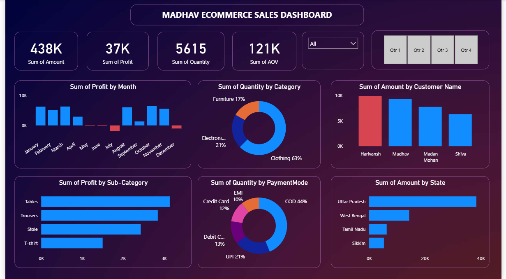

# Ecommerce-Sales-Dashboard
The Ecommerce Sales Dashboard is an interactive PowerBI project designed to analyze sales performance and business trends. It provides insights into sales, profit, product categories, customer segments, regional performance, and order distribution through charts, pivot tables, and interactive filters.
 

